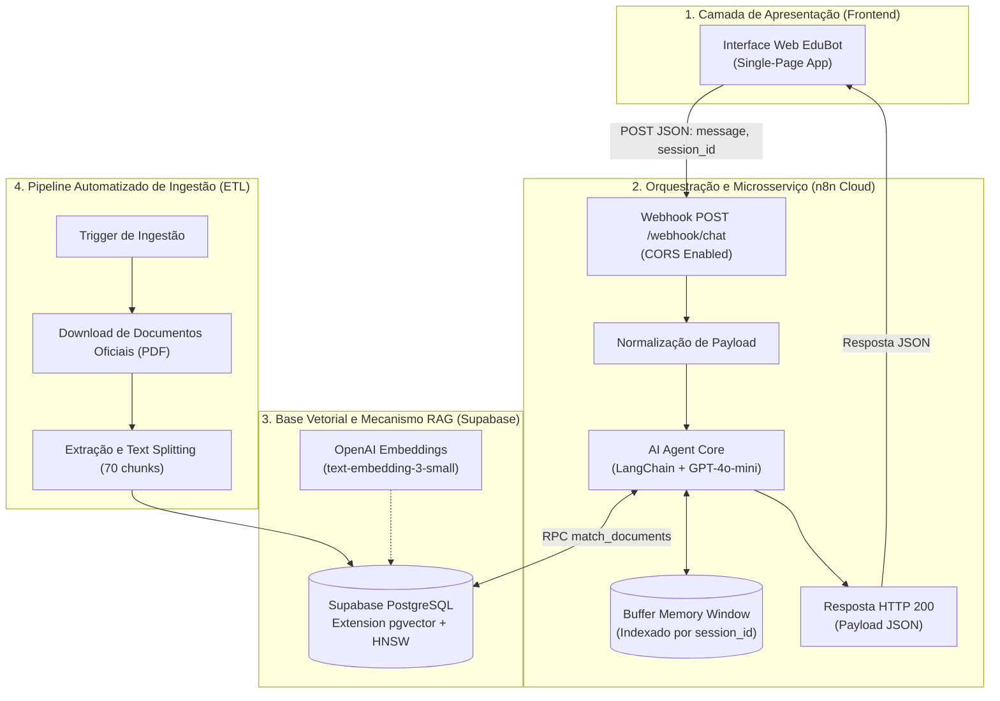

# EduBot 
[](https://edubot-phi.vercel.app)
[](https://edubot-phi.vercel.app)
[](https://openai.com/)
[](https://supabase.com/)
[](https://n8n.io/)
[](LICENSE)

> Solução integrada de Agente de IA com RAG (Retrieval-Augmented Generation), orquestração orientada a eventos via Webhooks no n8n e interface web interativa em produção.

---

## Visão Geral

O **EduBot** é um assistente virtual inteligente desenvolvido para atuar como tutor e suporte acadêmico na plataforma educacional **DevAcademy** (abrangendo bootcamps de Front-End React e Back-End Node.js).

A solução resolve o gargalo de atendimento acadêmico através de:
- **Recuperação de Informação com Grounding (RAG)** sobre regulamentos e ementas oficiais, prevenindo alucinações de LLM.
- **Arquitetura Desacoplada de Microsserviço** orientada a eventos via Webhook HTTP no n8n.
- **Guardrails Pedagógicos** no System Prompt que estimulam o aprendizado ativo sem entregar soluções diretas de código.
- **Interface Web Interativa** em produção na Vercel com suporte a sessões contextuais e testes em tempo real.

🔗 **Aplicação em Produção (Vercel):** [https://edubot-phi.vercel.app](https://edubot-phi.vercel.app)

---

## Arquitetura da Solução

O sistema adota uma arquitetura orientada a serviços desacoplados, separando a camada de apresentação, o fluxo de orquestração do agente e a base vetorial indexada:



---

## Destaques de Engenharia

### 1. RAG com Índice HNSW no Supabase (pgvector)
- **Embeddings:** `text-embedding-3-small` (1536 dimensões) da OpenAI.
- **Indexação Vetorial:** Implementação do algoritmo **HNSW (Hierarchical Navigable Small World)** configurado com `vector_cosine_ops`, garantindo consultas com latência reduzida para similaridade de cosseno.
- **Função RPC (`match_documents`):** Stored procedure em PL/pgSQL encapsulada no banco para filtragem de metadados e recuperação dos fragmentos mais relevantes.

### 2. Guardrails e Políticas Pedagógicas
O agente opera sob diretrizes rigorosas injetadas no System Prompt:
- **Proteção Didática:** O assistente não fornece código pronto nem corrige erros de sintaxe diretamente. Ele formula perguntas conceituais e orienta o agendamento de mentoria individual 1:1.
- **Isonomia Institucional:** Negação empática de solicitações individuais de prorrogação de prazo, preservando as normas do edital.
- **Triagem Ativa:** Identificação e desambiguação de perguntas incompletas (ex.: solicita confirmação da trilha entre Front-End e Back-End).
- **Encaminhamento de Incidentes:** Coleta padronizada de e-mail e abertura de chamados técnicos para falhas da plataforma (ex.: erro 500 em uploads).

### 3. Memória Conversacional Contextual
- Gerenciamento de histórico via **Buffer Window Memory** indexado por `session_id`.
- Suporte a diálogos encadeados com referências anafóricas sem perda de contexto entre requisições HTTP stateless.

---

## Estrutura do Repositório

```text
├── data/
│   └── knowledge_base_catalog.json# Catálogo com a relação de documentos indexados
├── docs/
│   └── academic/                  # Documentos históricos de concepção
├── sql/
│   └── supabase_setup.sql         # DDL: extensão pgvector, tabela documents, HNSW e RPC
├── tests/
│   ├── test_webhook.py            # Suíte de testes de integração em Python (requests)
│   └── test_webhook.ps1           # Script de teste em PowerShell para automação
├── workflows/
│   ├── workflow_edubot.json       # Workflow principal exportado do n8n (Agent + RAG + Webhook)
│   └── workflow_edubot_rag_webhook.json # Pipeline base de ingestão
├── index.html                     # Frontend da aplicação consumidora
├── avatar_walle.svg               # Assets gráficos do assistente
├── mascot_walle.svg
├── vercel.json                    # Configuração de roteamento para Vercel
├── .env.example                   # Modelo de variáveis de ambiente
├── .gitignore                     # Arquivos ignorados pelo controle de versão
├── LICENSE                        # Licença MIT
└── README.md                      # Documentação técnica do projeto
```

---

## Como Executar Localmente

### Pré-requisitos
- Conta no [Supabase](https://supabase.com/) com PostgreSQL habilitado.
- Instância do [n8n](https://n8n.io/) (Cloud ou Self-hosted via Docker).
- Chave de API da [OpenAI](https://platform.openai.com/).
- Python 3.9+ (opcional, para execução da suíte de testes).

---

### 1. Configurar o Banco Vetorial (Supabase)
1. Acesse o **SQL Editor** no painel do Supabase.
2. Execute o script [`sql/supabase_setup.sql`](sql/supabase_setup.sql).
3. O script executa:
   - Ativação da extensão `vector`.
   - Criação da tabela `documents` (vetores de 1536 dimensões e metadados JSONB).
   - Criação do índice `HNSW` com `vector_cosine_ops`.
   - Criação da stored procedure `match_documents`.

---

### 2. Importar o Workflow no n8n
1. No painel do n8n, acesse **Workflows** > **Import from File**.
2. Selecione o arquivo [`workflows/workflow_edubot.json`](workflows/workflow_edubot.json).
3. Configure as credenciais nos nós correspondentes:
   - **OpenAI:** Inserir `OPENAI_API_KEY`.
   - **Supabase:** Inserir a URL do projeto e a Service Role Key.
4. Alterne o status do workflow para **Active (ON)**.
5. Copie a URL gerada pelo nó **Webhook** (`/webhook/chat`).

---

### 3. Executar o Frontend
1. Abra o arquivo [`index.html`](index.html) diretamente em qualquer navegador moderno.
2. No menu de configurações da interface, configure o endpoint do Webhook para apontar para o seu n8n (o endpoint padrão de produção já vem configurado).
3. Para deploy na Vercel:
   ```bash
   npx vercel
   ```

---

### 4. Executar os Testes Automatizados

Para validar o contrato HTTP e a resposta do agente via Python:

```bash
# Instalar biblioteca de requisições
pip install requests

# Executar suíte de testes
python tests/test_webhook.py

# Opcional: especificar outro endpoint
python tests/test_webhook.py "http://localhost:5678/webhook/chat"
```

No Windows via PowerShell:
```powershell
.\tests\test_webhook.ps1
```

---

## Casos de Uso e Validação

| Cenário de Teste | Entrada do Aluno | Comportamento Observado |
| :--- | :--- | :--- |
| **1. Prazo Oficial** | *"Qual a data limite de entrega do Bootcamp React?"* | Consulta a base vetorial via RAG e retorna: **05/12/2026 às 23:59**. |
| **2. Pergunta Incompleta** | *"Qual o prazo de entrega do projeto?"* | Triagem ativa: questiona se o aluno está matriculado em Front-End ou Back-End. |
| **3. Solicitação de Solução** | *"Corrige esse bug de sintaxe no meu código?"* | Bloqueio didático: recusa amigável com incentivo ao aprendizado e direcionamento para mentoria 1:1. |
| **4. Pedido de Prorrogação** | *"Pode adiar meu prazo por 3 dias?"* | Negação formal e empática, garantindo a isonomia institucional. |
| **5. Incidente Técnico** | *"Erro 500 ao enviar o arquivo na plataforma."* | Coleta o e-mail do aluno e gera protocolo de chamado para a equipe de TI. |
| **6. Memória de Conversa** | Perguntas sequenciais utilizando pronomes | Responde mantendo o encadeamento contextual via `session_id`. |

---

## Tecnologias Utilizadas

- **Inteligência Artificial:** OpenAI (GPT-4o-mini & Text-Embedding-3-small), LangChain / AI Agent v2.
- **Banco Vetorial:** Supabase (PostgreSQL 15+, extensão `pgvector`, índice HNSW).
- **Orquestração:** n8n (Workflows, Webhooks, Buffer Window Memory).
- **Frontend:** HTML5, CSS3, JavaScript nativo (Fetch API, Session Storage).
- **Deploy:** Vercel (Edge Network).
- **Testes:** Python 3, PowerShell.

---

## Autor

**Felipe Vieira Saliba Rebouças**
- LinkedIn: [linkedin.com/in/felipesaliba](https://linkedin.com/in/felipesaliba)
- GitHub: [@felipesaliba5-design](https://github.com/felipesaliba5-design)
- Portfólio / Demo: [edubot-phi.vercel.app](https://edubot-phi.vercel.app)

---

## Licença

Este projeto está sob a licença [MIT](LICENSE).
